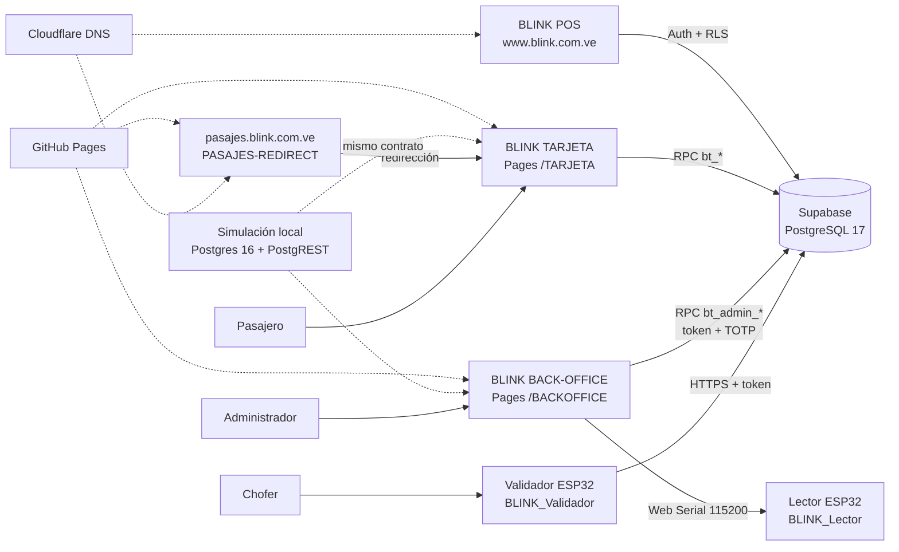

# Arquitectura del ecosistema

| Campo | Valor |
| --- | --- |
| Código | BLINK-DOC-02 |
| Versión | 1.4.0 |
| Fecha | 2026-10-31 |
| Estado | Vigente |
| Norma | ISO/IEC/IEEE 26514 · ISO/IEC/IEEE 42010 |

## 1. Vista de contexto



## 2. Componentes

| Componente | Tecnología | Despliegue | Responsabilidad |
| --- | --- | --- | --- |
| BLINK TARJETA | React 19 · Vite 8 · TS strict | GitHub Pages (Actions), base `/TARJETA/` | Cuenta, billetera, recargas, extracto. |
| BLINK BACK-OFFICE | React 19 · Vite 8 · TS strict · Web Serial | GitHub Pages (Actions), base `/BACKOFFICE/` | Lotes, inventario y estación de enrolado; exige rol administrativo y TOTP. |
| PASAJES-REDIRECT | HTML estático | GitHub Pages, CNAME `pasajes.blink.com.ve` | Redirige el dominio retirado a BLINK TARJETA conservando el ancla. |
| Simulación | PostgreSQL 16 · PostgREST v12 · nginx | Docker local (`simulacion/`) | Reproduce el contrato RPC y el flujo completo sin producción. |
| BLINK POS | React 19 · Vite 8 · Konsta · Supabase JS | GitHub Pages rama `gh-pages` + Cloudflare | Comercio: ventas, caja, catálogo (fuera de esta suite). |
| Backend | Supabase (PostgREST + PostgreSQL 17.11) | Gestionado | Datos, RLS, RPC `bt_*`, pgcrypto. |
| Firmware lector | ESP32 + MFRC522 (Arduino) | Flasheo local | Emite `READY,BLINK,1`, `CARD,<UID>`, `PONG`. |
| Firmware validador | ESP32 + MFRC522 + GPS/4G/OLED | Flasheo local | Cobro offline, sincronización con token. |
| DNS | Cloudflare (zona `blink.com.ve`) | Gestionado | `www`, `pasajes` (redirección) y correo. |

## 3. Flujos principales

### 3.1 Registro y vinculación (BLINK TARJETA)

```text
Usuario → Acceso.tsx (2 pasos) → repo.ts → nube.ts
        → POST /rest/v1/rpc/bt_registrar  → token + billetera
        → POST /rest/v1/rpc/bt_vincular   → tarjeta en la billetera
```

- El PIN viaja una sola vez; el servidor guarda `crypt(pin, gen_salt('bf',10))`
  (bcrypt vía pgcrypto). El token de sesión es un UUID con 12 h de vigencia.
- El modo demostración (`src/lib/local.ts`) replica el mismo contrato con
  `localStorage` y se activa cuando faltan las variables de entorno.

### 3.2 Recarga por Pago Móvil

```text
TARJETA: bt_recargar → card_movements (pendiente) + recharges
Back-office/RPC: bt_aprobar_recarga → acredita saldo, estado 'aprobada'
                 bt_rechazar_recarga → estado 'rechazada'
Validador: bt_validador_sincronizar_token recibe recargas aprobadas
```

### 3.3 Cobro a bordo

```text
Validador (offline) → cobra en el chip con Read-After-Write
        → guarda taps con offline_id y el contador del chip
        → HTTPS POST bt_validador_sincronizar_token (Bearer token del validador)
        → descuenta saldo, registra trips_telemetry (+ chip_counter),
          devuelve lista negra y recargas
```

Cada toque cobra un pasaje. Si la escritura o la relectura de comprobación
fallan, la tarjeta pasa a la lista local `inciertas` y se rechaza hasta revisión
manual; ver BLINK-DOC-16 §4.

### 3.4 Liquidación

`bt_liquidar(vehicle, desde, hasta)` agrupa viajes, aplica comisión y aporte de
línea, y registra el cierre en `settlements`.

## 4. Capas de BLINK TARJETA

| Capa | Archivos | Notas |
| --- | --- | --- |
| Presentación | `src/pages/*`, `src/components/*` | BEM + tokens CSS; tarjeta con container queries (`cqw`). |
| Dominio | `src/lib/dominio.ts`, `formato.ts`, `pin.ts`, `codigos.ts` | Validaciones puras, probadas con Vitest. |
| Repositorio | `src/lib/repo.ts` | Elige nube o local según configuración. |
| Acceso a datos | `src/lib/nube.ts` | `fetch` a RPC; traduce `bt:<código>:<mensaje>`. |
| Datos locales | `src/lib/local.ts` | Semilla de demostración, misma forma que la nube. |

Regla de diseño: **ninguna pantalla llama a `fetch` directamente**; todo pasa por
`repo`. Así el modo local y el modo nube se mantienen intercambiables.

## 5. Entornos

| Entorno | URL | Datos |
| --- | --- | --- |
| Desarrollo | `npm run dev` → `http://localhost:5173` | Local (sin variables) o nube por `.env.local`. |
| Simulación | `http://127.0.0.1:5175/` (portal) · `:5173` (panel) | PostgreSQL 16 local en `127.0.0.1:54329` vía gateway `:54321`. |
| Producción TARJETA | `https://blink-servers.github.io/TARJETA/` | Supabase real. |
| Producción back-office | `https://blink-servers.github.io/BACKOFFICE/` | Supabase real. |
| Redirección PASAJES | `https://pasajes.blink.com.ve/` | Sin datos; redirige a TARJETA. |
| Producción POS | `https://www.blink.com.ve/` | Supabase real (Auth + `businesses`). |

## 6. CI/CD

| Repo | Disparador | Pasos | Publicación |
| --- | --- | --- | --- |
| TARJETA | push a `main` / manual | `npm ci` → typecheck → test → build (`--base=/TARJETA/`) | `upload-pages-artifact` + `deploy-pages` |
| BACKOFFICE | push a `main` / manual | `npm ci` → typecheck → test → build (`--base=/BACKOFFICE/`) | `upload-pages-artifact` + `deploy-pages` |
| PASAJES-REDIRECT | push a `main` | sin compilación (HTML estático) | `deploy-pages` |
| POS | manual (`npm run deploy`) | `build:pages` (404.html + `.nojekyll`) | rama `gh-pages` |

Variables de configuración (no secretas):

| Repo | Variable | Contenido |
| --- | --- | --- |
| TARJETA | `VITE_SUPABASE_URL` | `https://gakkfzqcrapxeierfdhk.supabase.co` |
| TARJETA | `VITE_SUPABASE_ANON_KEY` | Clave publishable del proyecto |
| POS | `VITE_SUPABASE_URL`, `VITE_SUPABASE_PUBLISHABLE_KEY` | En `app/.env.local`, nunca en git |

Si las variables de TARJETA faltan, el build no falla: la app arranca en modo
demostración. Es una decisión deliberada para que un fork sin backend siga siendo
usable.

## 7. Decisiones de arquitectura (ADR resumidas)

| # | Decisión | Motivo | Consecuencia |
| --- | --- | --- | --- |
| ADR-01 | Supabase en lugar de backend propio. | Menos operación, RLS y PostgREST listos. | Dependencia del proveedor y del pooler para IPv4. |
| ADR-02 | Cuenta con N tarjetas (no tarjeta con PIN). | Familias recargan varias tarjetas. | Requiere migración 0005 y billetera en la UI. |
| ADR-03 | PIN y datos sensibles solo en RPC `security definer`. | `anon` no puede leer tablas. | Toda consulta nueva necesita su RPC. |
| ADR-04 | Tarjeta virtual con `container-type: inline-size` y `cqw`. | Mantiene la proporción ID-1 sin JS. | El CSS interior se expresa en `cqw`. |
| ADR-05 | Modo local espejo del contrato de nube. | Permite demo y desarrollo sin backend. | Hay que mantener dos implementaciones. |
| ADR-06 | Tokens de validador con `bt_validador_emitir_token`. | Evita usar la clave pública para operar. | Requiere provisioning por dispositivo. |
| ADR-07 | Simulación local con Postgres + PostgREST + nginx en lugar de un Supabase de pruebas. | Permite probar el flujo completo sin cuota, red ni datos reales, y el gateway imita `/rest/v1/`. | Hay que mantener el compose y el gateway cuando cambie el contrato. |
| ADR-08 | Retirar BLINK PASAJES y redirigir su dominio con un repo estático. | El panel duplicaba funciones del back-office y no tenía acceso al DNS por API. | `pasajes.blink.com.ve` depende de GitHub Pages y de su CNAME. |
| ADR-09 | Un toque, un pasaje; sin multi-toque acumulado ni antirebote de 15 s. | Cada cargo es visible y determinista; el gesto acumulado castiga el doble toque involuntario. | Pagar por dos exige retirar la tarjeta entre toques. |
| ADR-10 | Llaves derivadas por UID en lugar de bloquear el bloque de identidad. | Permite re-enrolar la maestra y migrar formatos v1→v3. | Quien tenga la `MASTER_KEY` puede reescribir tarjetas. |
| ADR-11 | Sin relé de torniquete; aviso por pantalla y buzzer. | El hardware de a bordo no tiene GPIO de potencia reservado. | «Cero saldo = cero acceso» depende del conductor o de la unidad. |
| ADR-12 | Códigos POS `ISO-00`/`ERR-xx` en pantalla y serie, sin migrar el panel a 128×128. | El panel es ST7789 240×240 y el diagnóstico vivo es un requisito operativo. | La geometría exacta de la especificación no se replica (DOC-17). |
| ADR-13 | `ERR-91` (repetir el toque) solo antes de escribir; un timeout durante la escritura es `ERR-63` e incierta. | Antes del decremento no hay nada que reconciliar; después sí. | Un corte a media escritura nunca se reintenta a ciegas. |
