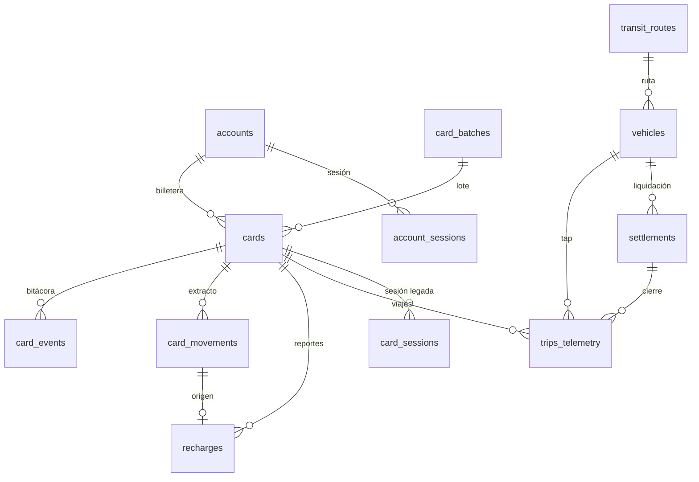

# Modelo de datos

| Campo | Valor |
| --- | --- |
| Código | BLINK-DOC-03 |
| Versión | 1.3.1 |
| Fecha | 2026-10-30 |
| Estado | Vigente |
| Norma | ISO/IEC/IEEE 26514 |
| Motor | PostgreSQL 17.11 (Supabase) |
| Esquema | `public` · criptografía en `extensions` |

## 1. Principios

1. **Una sola base** para todo el ecosistema: proyecto `gakkfzqcrapxeierfdhk`. Los
   cambios se versionan como migraciones SQL.
2. **RLS activo** en todas las tablas: `anon` y `authenticated` no leen tablas
   directamente; solo ejecutan RPC `security definer`.
3. **Identidad en `accounts`**, no en el plástico. `cards.cedula` y
   `cards.pin_hash` quedan como legado de 0001–0004.
4. **Saldos como `numeric`**, nunca `float`, para evitar errores de redondeo.
5. **Trazabilidad**: `created_at`/`updated_at` con trigger `bt_tocar_actualizada()`
   en las tablas mutables.

## 2. Migraciones

| Archivo | Contenido | Estado en producción |
| --- | --- | --- |
| `0001_tarjeta.sql` | Núcleo: settings, lotes, rutas, vehículos, tarjetas, movimientos, recargas, liquidaciones, telemetría, sesiones de tarjeta y RPC del portal v1. | Aplicada |
| `0002_demo.sql` | Datos de demostración (3 tarjetas, rutas, vehículos, movimientos). | Aplicada |
| `0003_operacion.sql` | Operación: emisión, cobro, aprobación de recargas, bloqueo, lotes, pérdida, acreditación, sincronización y liquidación. | Aplicada |
| `0004_validador_token.sql` | Token por validador (`vehicles.sync_token_hash`) y RPC de emisión/revocación. | Aplicada |
| `0005_cuentas.sql` | Cuenta del pasajero, billetera multi-tarjeta, PIN de 6 dígitos, Pago Móvil de la cuenta y RPC del portal v2. | Aplicada el 2026-10-29 |
| `0006_lotes_corporativos.sql` | Aprovisionamiento en lote: estado `FABRICADA`, activación por reclamo, estación UID↔serial, bitácora `card_events`, purga archivada y cuenta administradora. | Aplicada el 2026-10-29 · prueba de aceptación en verde |
| `0007_backoffice_mfa.sql` | Segundo factor TOTP en `accounts`, sesión de back-office con RBAC, verificación RFC 6238 en el servidor y RPC administrativas que autentican por token (sin `service_role` en el navegador). | Aplicada el 2026-10-29 · prueba de aceptación en verde |
| `0008_backoffice_lectura.sql` | Consultas de solo lectura del panel: `bt_admin_lotes` y `bt_admin_tarjetas` (lotes e inventario con titular, estado y saldo). | Aplicada el 2026-10-29 |
| `0009_serie_siete_digitos.sql` | Serie de 7 dígitos (`23-1-0000001-9`) con Luhn genérico de 10 y 11 dígitos, tarjeta maestra, `fare_type = 0` y renumeración de las tarjetas `FABRICADA` sin uso. | Aplicada el 2026-10-30 · prueba de aceptación en verde |
| `0010_maestra_once_digitos.sql` | Serial maestro de 11 dígitos `00-0-0000000-0`: reescribe `bt_crear_tarjeta_maestra`, renumera la maestra existente y deja el evento `ASIGNADA` de canal `sistema`. | Aplicada el 2026-10-30 · prueba de aceptación en verde |

Reglas:

- Las migraciones son **idempotentes** (`if not exists`, `create or replace`) y se
  ejecutan en una sola transacción.
- Nunca se edita una migración ya aplicada: se crea la siguiente.
- Antes de aplicar en producción, se prueba en PostgreSQL local (contenedor
  `blink-eco`, puerto 55433) y se ejecuta el flujo RPC completo con `SET LOCAL ROLE
  anon` dentro de una transacción que termina en `ROLLBACK`.

## 3. Tablas del dominio de transporte

### 3.1 `accounts` — identidad del pasajero

| Columna | Tipo | Regla |
| --- | --- | --- |
| `id` | uuid | PK, `gen_random_uuid()` |
| `nombres`, `apellidos` | text | 2–60 caracteres sin dígitos |
| `cedula` | text | `^[VE]-\d{6,8}$` |
| `cedula_digitos` | text generada | dígitos de la cédula, índice único |
| `telefono` | text | `^0\d{10}$` |
| `correo` | text | formato de correo, índice único en minúsculas |
| `pin_hash` | text | `crypt(pin, gen_salt('bf',10))` |
| `intentos` / `bloqueado_hasta` | int / timestamptz | bloqueo 5 min tras 5 fallos |
| `pago_propio` | boolean | `true` = usa los datos del registro |
| `pago_banco`, `pago_telefono`, `pago_cedula` | text | fuente alterna (familiar) |
| `rol` | text | `PASAJERO` (defecto), `TAQUILLA` o `ADMIN`; base del control de acceso del back-office |
| `totp_secret` | text | secreto TOTP en base32 sin relleno; nulo hasta inscribir el dispositivo |
| `totp_activo` | boolean | `true` cuando el operador confirmó el primer código; habilita las RPC de inventario |
| `totp_confirmado_at` | timestamptz | sello de activación del segundo factor |
| `created_at`, `updated_at` | timestamptz | trigger de actualización |

Índices: `accounts_cedula_idx` (único por cédula), `accounts_correo_idx`
(único por correo en minúsculas). RLS activo, sin políticas para `anon`.

### 3.2 `account_sessions` — sesión de la cuenta

`token` (uuid PK), `account_id` (FK con `on delete cascade`), `creada`, `expira`
(12 h). Se purgan las vencidas en cada registro/entrada. RLS activo.

La misma tabla sirve al portal y al back-office. Lo que distingue una sesión
administrativa no es la fila, sino el `rol` de la cuenta, que `bt_admin_sesion`
vuelve a verificar en **cada** llamada: revocar el rol invalida el panel sin
tocar el token. `totp_secret` nunca sale de la base; solo lo leen las funciones
`security definer`.

### 3.3 `cards` — plásticos emitidos

Columnas relevantes: `visible_id` (ID BLINK único), `chip_uid`, `barcode_data`,
`state_code`, `fare_type`, `virtual_balance`, `last_chip_balance`, `status`,
`batch_id`, `nombre`, `tarifa`, `emitida`, `vence`, `account_id` (FK a `accounts`,
`on delete set null`), `asignada_at`, `asignada_por`, `enrolada_at`, `enrolada_por`.

Restricciones de `visible_id` (migración 0009):

- Formato `EE-T-SSSSSSS-C`: entidad de 2 dígitos, tarifa de 1, secuencial de **6 o
  7** dígitos y dígito verificador Luhn de 1.
- `bt_luhn_valido(visible_id)` ignora los guiones y calcula Luhn sobre el número
  completo, de modo que la serie heredada de 10 dígitos (`23-1-000001-9`) y la
  nueva de 11 (`23-1-0000001-9`) conviven sin migrar plásticos ya impresos.
- `barcode_data` es único y lo genera la base: 11 dígitos sin guiones para la
  serie nueva y 10 para la heredada.

`fare_type` admite `0`, `1` y `2`: `0` identifica la **tarjeta maestra**
`00-0-0000000-0`, `1` la tarifa general y `2` la estudiante. La maestra nace
`ACTIVE`, tiene `batch_id` nulo, se asigna a una cuenta y cobra la tarifa general
como cualquier otra tarjeta (ver BLINK-DOC-12).

Estados (aprovisionamiento en lote, ciclo de vida):

| Estado | Significado |
| --- | --- |
| `FABRICADA` | Pre-generada en un lote; sin dueño, sin saldo y no usable en el portal. |
| `ACTIVE` | Reclamada por una cuenta o asignada por taquilla. |
| `BLOCKED` | Bloqueada por operación o atención al cliente. |
| `LOST` | Reportada como perdida; irreversibles desde el portal. |

`account_id` es la pertenencia a la billetera. Una tarjeta solo puede estar en una
cuenta; los RPC `bt_vincular` (portal) y `bt_estacion_asignar` (taquilla) lo
garantizan con `for update`.

### 3.4 `card_movements` — extracto

`card_id`, `tipo` (`recarga`, `viaje`, …), `monto`, `saldo_despues`, `detalle`,
`estado` (`pendiente`, `aprobada`, `rechazada`), `unidad`, `banco`, `referencia`,
`at`.

### 3.5 `recharges` — reportes de Pago Móvil

`card_id`, `movement_id`, `amount`, `bank`, `bank_reference`, `sender_phone`,
`status`, `synced_to_chip`, `synced_at`, `created_at`, `resolved_at`,
`resolved_by`. Índice parcial de pendientes.

### 3.6 `trips_telemetry` — telemetría de viajes

`card_id`, `vehicle_id`, `route_id`, `movement_id`, `fare_charged`, `fare_type`,
`latitude`, `longitude`, `validator_mac`, `offline_id` (único por tap),
`chip_balance_after`, `settled`, `settlement_id`, `tapped_at`, `synced_at`.

### 3.7 `settlements` — liquidaciones

`vehicle_id`, `period_start`, `period_end`, `trips_count`, `gross`,
`commission_pct`, `commission`, `line_fee`, `net`, `status`, `bank_reference`,
`created_at`, `paid_at`.

### 3.8 Catálogo y configuración

- `settings` (`clave`, `valor jsonb`, `actualizada`): configuración pública
  (`publico` → atención, Pago Móvil, `topeRecarga`).
- `card_batches`: lotes de producción; numera los seriales y guarda
  `sponsor_name`, `cards_quantity`, `state_code`, `fare_type`, `origen`
  (`FABRICANTE`/`ESTACION`), `creado_por` y `cerrado_at`.
- `transit_routes`: rutas y tarifas general/estudiante.
- `vehicles`: unidades, chofer, datos bancarios, MAC del validador,
  `commission_pct`, `line_fee`, `sync_token_hash`.

### 3.9 `card_events` — bitácora del plástico

`card_id` (FK con `on delete cascade`), `evento` (`ENROLADA`, `ASIGNADA`,
`PERDIDA`), `canal` (`portal`, `taquilla`, `estacion`, `sistema`), `operador`,
`detalle jsonb` y `at`. RLS activo y sin permisos para `anon`/`authenticated`.

Cada enrolamiento, asignación y reporte de pérdida deja una fila: es la traza que
exige la auditoría del ciclo de vida del inventario.

### 3.10 Esquema `respaldo`

La migración `0006` archiva las tablas operativas en `respaldo.*_0006` antes de
purgarlas y deja constancia en `respaldo.bitacora`. El esquema no tiene permisos
para `anon`/`authenticated`; se consulta solo desde la consola SQL.

## 4. Relaciones

## 5. Reglas de negocio en base de datos

| Regla | Implementación |
| --- | --- |
| PIN de 6 dígitos no trivial | `bt_pin6_valido` |
| Serial con Luhn | `bt_luhn_valido` (10 u 11 dígitos, serie heredada y nueva) |
| Tarjeta maestra | `bt_crear_tarjeta_maestra` inserta `00-0-0000000-0` con `fare_type = 0`; solo `service_role` |
| Vigencia de la tarjeta | `bt_tarjeta_vigente` (vence > hoy) |
| Tope de recarga | `bt_tope_recarga` lee `settings.publico.topeRecarga` (defecto 5.000) |
| Referencia duplicada | `bt_recargar` consulta `recharges` por tarjeta+banco+referencia |
| Ráfaga de reportes | máximo 6 reportes por tarjeta en 10 minutos |
| Bloqueo por PIN | 5 fallos → 5 minutos (`intentos`, `bloqueado_hasta`) |
| Sesión | 12 h por token |
| Tarjeta reclamable | solo `FABRICADA` o `ACTIVE` sin `account_id`; el resto responde `bloqueada` |
| Activación | `bt_vincular`/`bt_estacion_asignar` pasan a `ACTIVE`, sellan `asignada_at` y escriben en `card_events` |
| UID único | índice único en `cards.chip_uid`; la estación rechaza el UID repetido |
| Pérdida | prohibida sobre `FABRICADA` (aún sin dueño) |
| Acceso al back-office | `bt_admin_sesion` exige token vigente y `rol in (ADMIN, TAQUILLA)` |
| Operación con inventario | `bt_admin_sesion_mfa` exige además `totp_activo = true` |
| Código TOTP | RFC 6238 (HMAC-SHA1, 30 s, 6 dígitos) con ventana de ±1 paso |

## 6. Compatibilidad con el esquema del comercio (POS)

BLINK POS usa `auth.users`, `businesses` y `catalogo_global` en el mismo proyecto.
No hay claves foráneas entre ambos dominios: el aislamiento es por RLS y por
propiedad (`businesses.owner_id = auth.uid()`). Al crear una migración nueva:

1. No renombrar ni eliminar objetos de `businesses`/`catalogo_global`.
2. No conceder permisos a `anon` sobre tablas nuevas.
3. Probar el `npm test` de POS antes de aplicar en producción.

## 7. Copias de seguridad y recuperación

- Supabase realiza copias automáticas diarias (plan del proyecto). Para una copia
  lógica manual: `pg_dump` contra el pooler (`sslmode=require`).
- **Restauración:** crear una base nueva, aplicar `0001`→`0010` y cargar el dump.
  Verificar `select count(*)` de `cards`, `card_movements` y `accounts`.
- La contraseña de la base **no se documenta aquí**; vive en el gestor de secretos
  del equipo (ver BLINK-DOC-05 §6).
